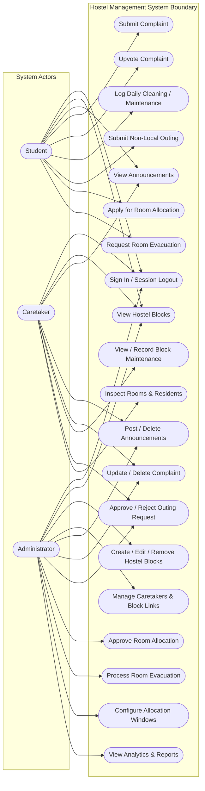
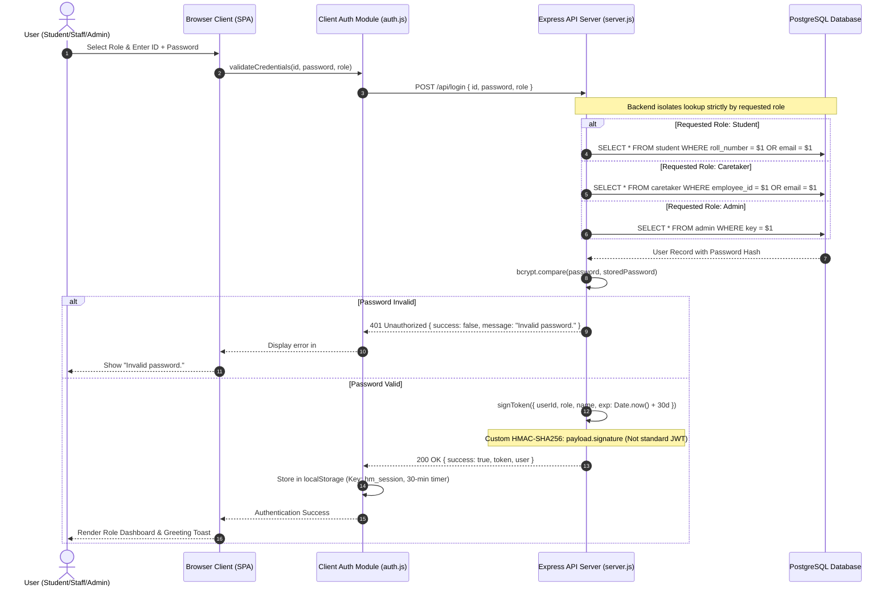
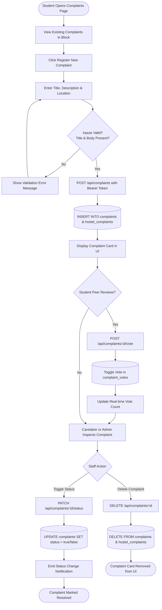
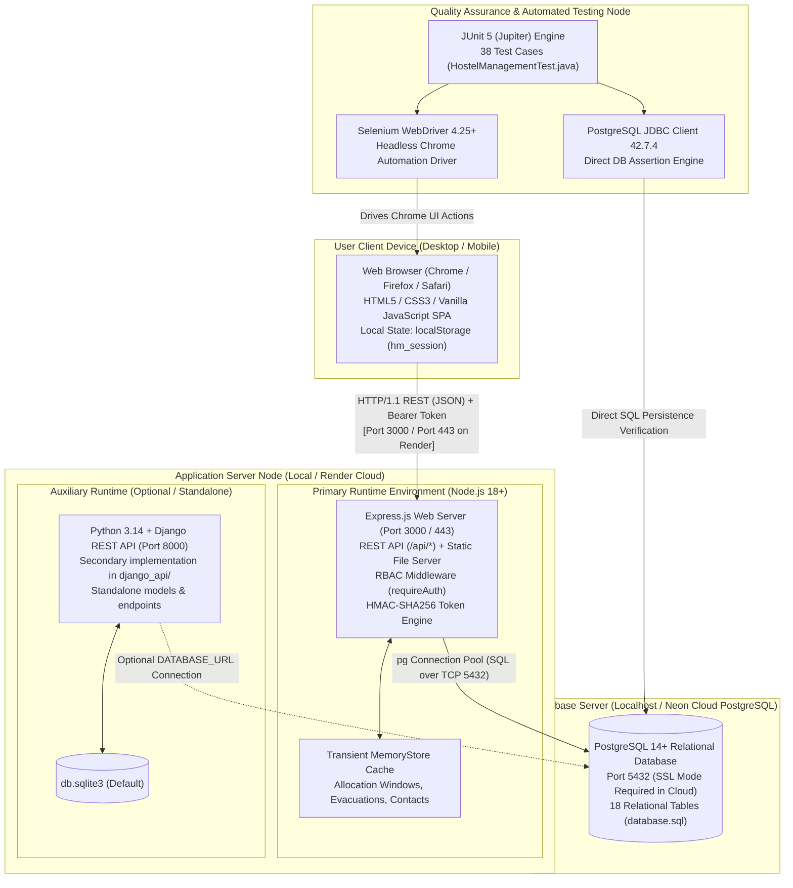

# Hostellers
## Hostel Management System
### UML Architectural & Design Specifications

**Project Team Members:**
- **M.Sanjay pal** — `424150`
- **Raj Gireesh** — `424169`
- **P.Jyothiswar** — `424165`

---

## Overview

This document presents the visual Unified Modeling Language (UML) specifications for the **Hostellers** Hostel Management System. The diagrams model the actual verified architecture, domain data structures, security flows, operational lifecycles, and component deployment topologies implemented in the repository codebase (`frontend/`, `backend/server.js`, and `backend/database.sql`).

---

## 1. Use Case View

### Description & Scope
The Use Case View depicts the functional boundaries of the Hostel Management System, illustrating how the three primary actors (**Student**, **Caretaker**, and **Administrator**) interact with system capabilities. 

*Key Access Control Boundary*: Caretakers can view assigned hostel blocks and residents, but are strictly prohibited from adding, modifying, or removing hostel blocks. Hostel block administration is reserved exclusively for Administrators. Both Caretakers and Administrators possess rights to post/delete announcements and manage/delete complaints.

---

## 2. Domain Class Diagram

### Description & Scope
The Domain Class Diagram models the persistent relational data structure defined in `backend/database.sql`. It illustrates the 18 core entities, primary/foreign key attributes, and multiplicity relationships maintained by the PostgreSQL engine. Transient in-memory structures (such as active allocation windows and notifications) reside in `memoryStore` in the Express runtime.

```mermaid
classDiagram
  class Admin {
    +VARCHAR(255) key PK
    +VARCHAR(255) password
  }

  class Caretaker {
    +VARCHAR(255) employee_id PK
    +VARCHAR(255) name
    +BIGINT phone_number
    +VARCHAR(255) email UK
    +VARCHAR(255) password
  }

  class Student {
    +INTEGER roll_number PK
    +INTEGER registered_number UK
    +VARCHAR(255) name
    +INTEGER year
    +BIGINT phone_number
    +VARCHAR(255) email UK
    +VARCHAR(255) password
    +VARCHAR(50) gender
  }

  class HostelBlock {
    +VARCHAR(255) block_id PK
    +VARCHAR(255) name
    +INTEGER floors
    +INTEGER seater
    +INTEGER capacity
    +VARCHAR(50) for_gender
  }

  class HostelYear {
    +VARCHAR(255) block_id PK, FK
    +INTEGER student_year PK
  }

  class HostelFloorRooms {
    +VARCHAR(255) block_id PK, FK
    +INTEGER floor_number PK
    +INTEGER number_of_rooms
  }

  class Room {
    +VARCHAR(255) room_id PK
    +VARCHAR(255) block_id FK
    +INTEGER room_number
    +INTEGER floor_number
  }

  class CaretakerHostel {
    +VARCHAR(255) employee_id PK, FK
    +VARCHAR(255) block_id PK, FK
  }

  class StudentHostel {
    +INTEGER roll_number PK, FK
    +VARCHAR(255) room_id PK, FK
  }

  class Complaint {
    +VARCHAR(255) complaint_id PK
    +INTEGER roll_number FK
    +VARCHAR(255) room_id FK
    +DATE date
    +TIME time
    +TEXT complaint
    +BOOLEAN status
    +INTEGER votes
  }

  class HostelComplaint {
    +VARCHAR(255) block_id PK, FK
    +VARCHAR(255) complaint_id PK, FK
  }

  class ComplaintVote {
    +VARCHAR(255) complaint_id PK, FK
    +VARCHAR(255) user_id PK
  }

  class Maintenance {
    +VARCHAR(255) maintenance_id PK
    +INTEGER roll_number FK
    +VARCHAR(255) room_id FK
    +DATE date
    +TIME time
    +BOOLEAN mopping_status
    +BOOLEAN cleaning_status
    +TEXT remarks
  }

  class HostelMaintenance {
    +VARCHAR(255) block_id PK, FK
    +VARCHAR(255) maintenance_id PK, FK
  }

  class Outing {
    +VARCHAR(255) outing_id PK
    +INTEGER roll_number FK
    +DATE from_date
    +DATE to_date
    +TEXT purpose
    +BIGINT parent_ph_no
    +DATE date
    +TIME time
    +BOOLEAN status
  }

  class HostelOuting {
    +VARCHAR(255) block_id PK, FK
    +VARCHAR(255) outing_id PK, FK
  }

  class Announcements {
    +VARCHAR(255) announcement_id PK
    +DATE date
    +TIME time
    +TEXT announcement
  }

  class HostelAnnouncements {
    +VARCHAR(255) block_id PK, FK
    +VARCHAR(255) announcement_id PK, FK
  }

  %% Multiplicity Relationships
  HostelBlock "1" --> "0..*" Room : contains
  HostelBlock "1" --> "0..*" HostelYear : restricts by year
  HostelBlock "1" --> "0..*" HostelFloorRooms : specifies floors
  HostelBlock "1" --> "0..*" CaretakerHostel : assigned to
  Caretaker "1" --> "0..*" CaretakerHostel : oversees

  Room "1" --> "0..*" StudentHostel : houses
  Student "1" --> "0..*" StudentHostel : resides in

  Student "1" --> "0..*" Complaint : submits
  Room "1" --> "0..*" Complaint : location of
  Complaint "1" --> "0..*" ComplaintVote : receives
  HostelBlock "1" --> "0..*" HostelComplaint : groups
  Complaint "1" --> "0..*" HostelComplaint : linked to

  Student "1" --> "0..*" Maintenance : logs
  Room "1" --> "0..*" Maintenance : subject of
  HostelBlock "1" --> "0..*" HostelMaintenance : groups
  Maintenance "1" --> "0..*" HostelMaintenance : linked to

  Student "1" --> "0..*" Outing : requests
  HostelBlock "1" --> "0..*" HostelOuting : groups
  Outing "1" --> "0..*" HostelOuting : linked to

  Announcements "1" --> "0..*" HostelAnnouncements : published across
  HostelBlock "1" --> "0..*" HostelAnnouncements : receives
```

---

## 3. Sign-In Sequence Diagram

### Description & Scope
The Sequence Diagram depicts the end-to-end credential authentication, token generation, and role dispatch workflow. It accurately models:
1. Client-side input validation and submission.
2. The Express backend executing targeted database lookup based strictly on the selected role (`student`, `caretaker`, or `admin`).
3. Password verification using `bcrypt.compare` (or constant-time match for seed fallbacks).
4. Generation of a custom HMAC-SHA256 signed bearer token (`${base64urlPayload}.${signature}`).
5. Client-side session creation with a 30-minute inactivity timer in `localStorage`.

---

## 4. Complaint Submission & Lifecycle Activity Diagram

### Description & Scope
This Activity Diagram maps the lifecycle of a student maintenance complaint from submission, input validation, and database insertion through to caretaker/admin review, status toggling, and final deletion.

---

## 5. Deployment / Component Diagram

### Description & Scope
The Deployment Diagram illustrates the physical and logical runtime nodes, communication protocols, network boundaries, and testing infrastructure. It explicitly represents the optional, auxiliary nature of the Python/Django API.

---

## 6. Consistency and Traceability Verification

1. **Protocol Uniformity**: All client-server interactions between the browser SPA and backend REST API use HTTP/1.1 in local development and TLS/HTTPS when hosted behind a reverse proxy (e.g., Render edge).
2. **Entity Consistency**: All database entities (`admin`, `student`, `caretaker`, `hostel`, `room`, `complaints`, `maintenance`, `outing`, `announcements`) match table definitions in `backend/database.sql`.
3. **Role & Permission Alignment**:
   - `student`: restricted to submitting complaints, upvoting, logging cleaning, submitting outings, applying for allocation/evacuation during open windows.
   - `caretaker`: restricted to assigned blocks; can post/delete announcements and update/delete complaints; strictly forbidden from block administration.
   - `admin`: global administrative authority across blocks, caretakers, allocations, windows, and institutional records.
4. **Token Security Model**: The system relies on a two-part HMAC-SHA256 signature scheme (`base64url(payload).signature`) rather than standard 3-part JWT.
